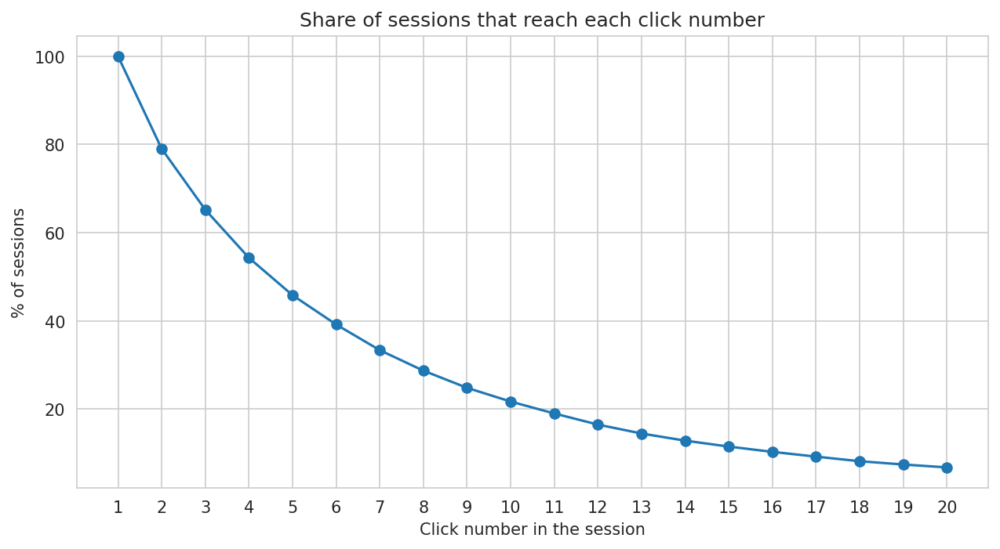
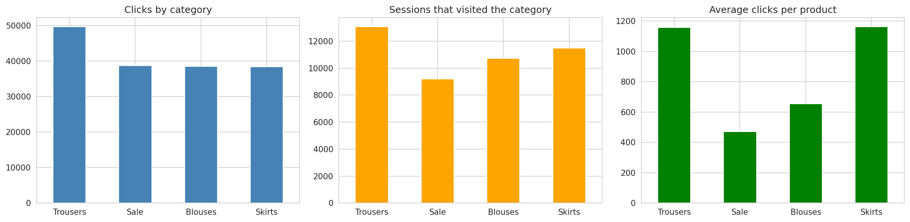
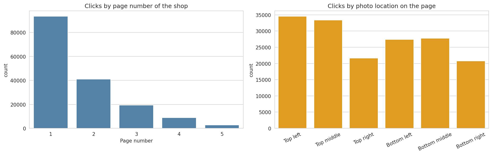

# Online Shopping Clickstream & Customer Behavior Analysis using Python

Exploratory Data Analysis (EDA) project on clickstream data from an online clothing store, built for the Bleep EDA Project Assignment (Project 04).

## Project Objective
An e-commerce company wants to understand how users interact with its website and find patterns in online shopping behaviour. The goal of this project is to clean the clickstream data, explore it with Python, and turn the results into insights and recommendations.

## Dataset
- **Name:** UCI Clickstream Data for Online Shopping (e-shop clothing 2008)
- **Link:** https://archive.ics.uci.edu/dataset/553/clickstream+data+for+online+shopping
- **Size:** 165,474 rows (one row = one click on one product) and 14 columns, grouped into 24,026 sessions
- **Period:** 1 April 2008 to 13 August 2008
- The file uses `;` as separator. Download the CSV (`e-shop clothing 2008.csv`) from the link above.
- **Important:** the dataset has no purchase column, so real conversion cannot be measured. I use a proxy, "highly engaged session" (more clicks than 75% of sessions), and always say so.

Dataset source: Łapczyński M., Białowąs S. (2013) *Discovering Patterns of Users' Behaviour in an E-shop - Comparison of Consumer Buying Behaviours in Poland and Other European Countries*, Studia Ekonomiczne, nr 151, p. 144-153.

## Tools Used
Python, Pandas, NumPy, Matplotlib, Seaborn, Google Colab

## Analysis Performed
1. **Data understanding:** shape, data types, summary statistics, data dictionary
2. **Data quality checks:** missing values, duplicates, click-order sequence, one country per session, product code vs category (1 wrong row removed), consistency of the price 2 column
3. **Data preparation:** real dates and weekdays, names instead of codes, session-level table
4. **Outlier analysis:** IQR rule and the longest sessions
5. **Frequency analysis:** categories, pages, photo locations, countries, products, colours
6. **Cross-variable analysis:** category x location heatmap, price by category, price vs clicks
7. **Session behaviour:** drop-off curve, clicks per session by month
8. **Time-series analysis:** daily sessions and weekday pattern
9. **Engagement analysis (proxy for conversion)** by country, first category and other variables
10. **Correlation analysis:** Spearman heatmap of session features

After cleaning: 165,473 clicks, 24,026 sessions, 217 products and 47 country codes.

## Key Findings
- **Categories:** Trousers get the most attention (49,742 clicks, 54% of sessions). Skirts and trousers get about 1,160 clicks per product, while the sale category gets only 473 even though it has the most products (82).
- **Pages:** Page 1 gets 56.5% of clicks and page 5 only 1.7%.
- **Photo location:** Top left (20.9%) and top middle (20.2%) get the most clicks; bottom right gets the least (12.5%).
- **Countries:** Poland gives 81.5% of sessions, then the Czech Republic (9.4%), .net (2.8%) and Lithuania (2.2%).
- **Price:** More expensive products are not clicked less (Spearman 0.23 between price and clicks per product), although position on the page mixes with this effect.
- **Session behaviour:** The median session has 4 clicks. 21.0% of sessions have only one click, 39.6% never leave page 1, and only 45.8% reach the fifth click.
- **Engagement (proxy):** 24.8% of sessions are highly engaged. They visit about 2.8 categories (against 1.5) and look more at sale items. The Czech Republic has the highest engaged share (28.9%) and .net the lowest (10.6%).
- **Unusual behaviour:** 17 sessions have more than 100 clicks (maximum 195). .net sessions have a median of 1 click and 53% single-click sessions, which suggests robots or low-quality traffic.
- **Time:** About 178 sessions per day on average. Tuesday is the busiest day and Saturday the quietest.





## Important Insights and Recommendations
1. **Put the products you want to sell most on page 1 and in the top-left / top-middle positions** (and A/B test this).
2. **Reduce early drop-off:** the first page should lead users to more products (related items, filters, easy navigation).
3. **Recommend products across categories,** because engaged users explore several categories.
4. **Improve the sale section:** show fewer, better sale items higher up.
5. **Target the Czech Republic and Lithuania,** which have the most engaged users after Poland.
6. **Check the .net traffic quality** and filter robots from the statistics.
7. **Record purchases and add-to-cart events** to measure real conversion.

## Limitations
- No purchase data, so conversion is only approximated by a proxy based on the number of clicks
- Only April to August 2008 (August incomplete), data from one clothing shop
- About 81% of traffic is from Poland, so other countries have little data
- Price and page position are mixed together, so the effect of price cannot be separated
- Exploratory analysis only. Correlation does not mean causation

## Repository Structure
```
├── Project04_Clickstream_EDA_Colab.ipynb   # full analysis, code and charts
├── EDA_Report_Project04.pdf                # final EDA report
├── Presentation.pptx                       # 5-8 slide summary
├── figures/                                # saved charts
└── README.md
```

## How to Run
1. Download the dataset from the link above
2. Open `Project04_Clickstream_EDA_Colab.ipynb` in Google Colab
3. Click Runtime -> Run all and upload the CSV file when the file picker appears

## Resume Description
Analyzed 165K+ clickstream records (24K shopping sessions) from an online clothing store using Python, Pandas, NumPy, Matplotlib and Seaborn to identify popular categories, page and country activity, session drop-off and engagement patterns, and recommended improvements to product placement and marketing.

## Author
Anunay Kumar Sah, B.Tech CSE, ITER (SOA)
GitHub: https://github.com/aksah20
